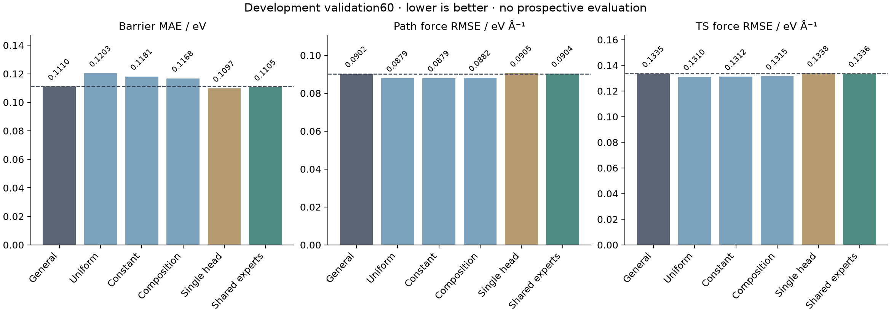

# MoE先导：实际权重、全部对照和计算成本

2026-11-25本地启动（计算记录使用UTC，终态为2026-11-26T05:58:27.903533+00:00）。
用户要求把论文成功机制落实为实际模型；本轮包含已训练外部门控和两个
真实训练的残差适配器，尚未进行prospective或端点搜索/独立DFT。

## 同一validation60、600个路径构型

| 模型 | 能垒MAE / eV | 全路径力RMSE / eV Å⁻¹ | TS区域力RMSE / eV Å⁻¹ |
| --- | ---: | ---: | ---: |
| 单一通用512 | 0.111033 | 0.090201 | 0.133513 |
| 三模型均匀混合 | 0.120337 | 0.087895 | 0.131017 |
| 学习常数软混合 | 0.118106 | 0.087938 | 0.131154 |
| 组成门控软混合 | 0.116760 | 0.088204 | 0.131507 |
| 普通单头适配，两轮 | 0.109724 | 0.090517 | 0.133825 |
| 共享残差专家，两轮 | 0.110541 | 0.090429 | 0.133637 |

外部门控仅在既定meta-development拟合；本表validation已参与底层MACE的
checkpoint选择，属于开发检查。残差适配只用MACE训练侧64条反应的512个
已有标签，两个模型各2实际epoch/256更新，相同种子/优化器/损失/数据。
其主干冻结；共享专家49,256个适配参数，普通宽单头49,248个参数。

## 外部软混合的化学式分组折外结果

| 模型 | 能垒MAE / eV | 全路径力RMSE / eV Å⁻¹ | TS区域力RMSE / eV Å⁻¹ |
| --- | ---: | ---: | ---: |
| 单一通用512 | 0.105757 | 0.084082 | 0.126574 |
| 三模型均匀混合 | 0.107852 | 0.082202 | 0.123949 |
| 学习常数软混合 | 0.107214 | 0.082124 | 0.123929 |
| 组成门控软混合 | 0.106635 | 0.082170 | 0.124203 |

128条反应、42个化学式、五折。所有外部混合的能垒差区间均跨零，且
validation能垒未优于通用模型；力误差有下降。故外部混合不晋级，不把
受力改善写成能垒或搜索能力的整体提升。基线重建与旧报告相符。

共享专家未通过本次短先导的共同指标与相近参数单头对照，不替换当前通用模型。两轮/64反应的结果不排除其他训练预算或结构。

## 并行主线：已完成的1024反应候选

既定OMEN扩展训练已有实际权重：coverage1024首种子20轮，validation60能垒
0.107966eV、全路径力0.085223eV/Å、TS力0.125427eV/Å，三项优于512基线。
模型56,942,889字节已回收并通过Mac重载/差分；尚为单种子开发候选，2048
和既定重复仍以真实队列为准。发布另附此标准`.model`权重及模型卡。
它扩大了训练标签覆盖，与本页冻结在512基线上的结构对照分开解释。


## 验收和成本

- 109项Python回归通过。外部门控解析梯度/角色拒绝、真实三MACE重载、
  能量与力中心差分、平移/旋转/排列检查通过。
- 外部混合差分力误差1.05e-06 eV/Å；
  8原子单构型CPU单线程实测约3.00倍单模型耗时。
  此小案例不是大规模速度基准。所有三个成员均参与推理，总170,835,273字节。
- 外部门控12次拟合共3.73秒，复用完整缓存；残差两模型训练与
  validation共594.7秒。新增GPU训练0小时、新增DFT标签0个。
- 共享主干保留坐标梯度，真实力损失可以更新专家及元素门控；两训练帧/三更新
  的接口检查仅证明数值可行，不计作科学训练精度结果。
- 两个残差适配器均保存并重载后完成完整validation；最终保留64+64未打开。
  外部门控、内部残差结构和数据规模的收益不合并归因。



## 使用发布模型包

解压到同一个目录，保留`models/v0.8.0`和`models/v0.11.0`路径；依赖沿用
项目锁定的MACE0.3.17/ASE3.29环境，不需要全局安装。门控JSON是已拟合参数，
残差PT是两轮真实权重；均依赖包中明确列出的底层MACE模型。

```python
from ase.io import read
from soft_mixture import CompositionMixtureCalculator

atoms = read("molecule.xyz")
atoms.calc = CompositionMixtureCalculator(
    "models/v0.11.0/composition_softmax.json", root=".", device="cpu")
energy, forces = atoms.get_potential_energy(), atoms.get_forces()
```

```python
from mace.calculators import MACECalculator
from residual_moe import SharedResidualMoE, ResidualMoECalculator

base = MACECalculator(model_paths="models/v0.8.0/mh1_global512_e40.model",
                      device="cpu", default_dtype="float64")
adapter = SharedResidualMoE.load_adapter("models/v0.11.0/shared_experts.pt", base.models[0])
atoms.calc = ResidualMoECalculator(adapter, base)
energy, forces = atoms.get_potential_energy(), atoms.get_forces()
```

仅验收非周期中性单重态CHNO。不要把外部门控当内部MoE，不把2轮小先导
当最终模型，不复用evaluation标签训练底层MACE。所有失败和对照继续保留。
研究设计、论文差异及后续晋级见`docs/design/soft-mixture.md`。
