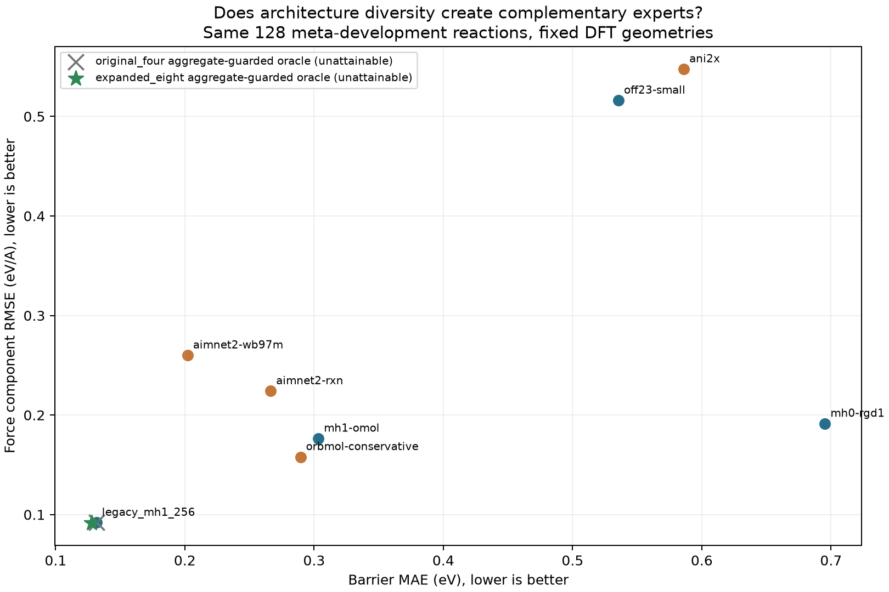

# 八模型、四架构家族的专家互补性先导结果

2026-11-23 用户提出原先全部为 MACE，专家池可能缺乏架构多样性。新增四个候选已在 Mac 本地完成实际权重推理和同一批反应评价；本轮是第一轮结果启发的探索性扩展，不是新的独立测试。

固定 128 条 meta-development 反应、每条十图像。新模型另完成 60 条 selection-validation；64+64 条后续 holdout 标签保持未打开。所有新模型的端点/TS 有限输出与双位移能量梯度检查通过。

| 固定模型 | 能垒 MAE (eV) | 力 RMSE (eV/Å) |
| --- | ---: | ---: |
| off23-small | 0.535547 | 0.516028 |
| mh1-omol | 0.303376 | 0.176436 |
| mh0-rgd1 | 0.695358 | 0.191374 |
| legacy_mh1_256 | 0.131575 | 0.091898 |
| aimnet2-wb97m | 0.202082 | 0.260025 |
| aimnet2-rxn | 0.266374 | 0.224079 |
| ani2x | 0.586107 | 0.547517 |
| orbmol-conservative | 0.289478 | 0.157906 |

新增 AIMNet2 与 AIMNet2-rxn 属于同一家族，ANI 与 Orb 是另外两个家族，因此总计八个候选、四个架构家族。ANI-2x 为官方八成员集合；AIMNet2 使用固定成员 0。

| 只用于诊断的理想选择 | 能垒 MAE (eV) | 力 RMSE (eV/Å) |
| --- | ---: | ---: |
| 旧四模型仅能垒 oracle | 0.089476 | 0.256783 |
| 八模型仅能垒 oracle | 0.060014 | 0.284927 |
| 八模型逐反应力约束 oracle | 0.131575 | 0.091898 |
| 八模型整体多指标约束 oracle | 0.127803 | 0.091828 |

全部 oracle 使用真实标签，不能部署。仅能垒 oracle 的改善伴随力和反应能恶化。逐反应要求力不劣化时，仍全部选择旧微调 MH-1；OrbMol 在 9 条反应上拥有最低力误差，但这些反应中没有同时改善能垒的逐反应赢家。

整体约束则允许不同反应之间的误差预算交换。整数优化要求整体力 MSE、平均逐反应 TS 力 RMSE 和反应能 MAE 均不劣于基线；HiGHS 找到并证明最优的硬选择，能垒 MAE 0.131575→0.127803 eV，约 2.87% 的理想改善。最终选择 123 次旧微调、3 次 OrbMol、1 次原 MH-0、1 次通用 AIMNet2。小幅互补性存在，但尚不能由此认定路由有效。

## 真实路由：五折化学式分组、同一组端点特征

复用第一轮已经固定的超参数，没有依据本轮 OOF 调参。每折只用训练部分拟合，并在该折训练部分选择固定专家基线。

| 方法 | 能垒 MAE (eV) | 力 RMSE (eV/Å) |
| --- | ---: | ---: |
| 折内选择的固定专家 | 0.131575 | 0.091898 |
| ridge | 0.183077 | 0.220902 |
| extratrees | 0.131340 | 0.093594 |
| tabpfn | 0.142009 | 0.106112 |
| tabicl | 0.150389 | 0.123578 |

ExtraTrees 只有 0.000235 eV 的能垒下降，同时力与反应能误差略升；其化学式聚类区间触及零。Ridge、TabPFN 和 TabICL 变差。本轮尚未获得兼顾能垒与受力的可部署路由器。

## 边界与后续

原始模型的理论水平不完全相同。ANI-2x 名义上与 Transition1x 同为 wB97X/6-31G(d)，AIMNet2/OrbMol 则有其他泛函、基组和色散约定。这里只减各模型自己的反应物能量，不混合原始能量，也不把跨方法差异全算成某一架构的缺陷。基础训练反应重叠尚未逐条确认。

本轮静态数据仅含 CHNO 中性单重态，118 条重排和 10 条裂解，无成键类；不能判断金属、离子、不同自旋等领域的专家分工。需要共同目标 DFT 的适配，以及固定预算的端点 NEB/TS/频率/IRC 比较来区分静态精度和真实搜索能力。

环境、权重、方法见 `configs/molecular-experts.json` 与 `docs/design/expert-diversity.md`。重建：`python scripts/analyze_expert_diversity.py`；完整路由记录为 `routing-summary.json`。

